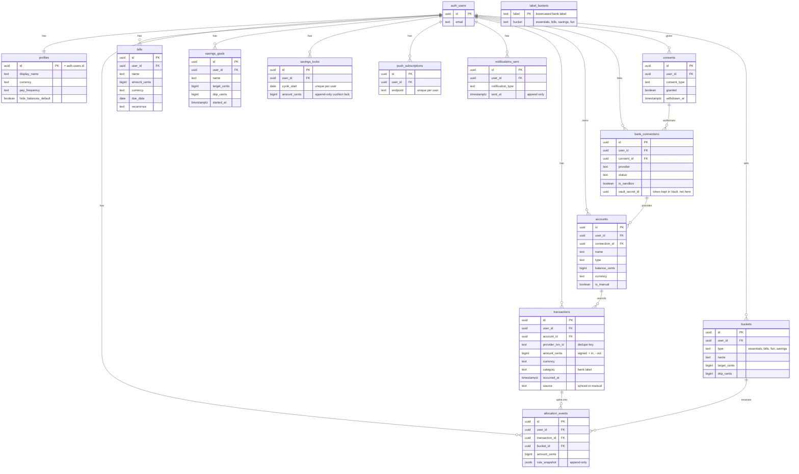

# Hyper Budget: Database diagram (ERD)

The tables in the `public` schema and how they relate. Every person-owned table
links back to `auth.users` (Supabase's built-in accounts table) through `user_id`,
which is how Row-Level Security keeps each person to their own rows. This renders as
a diagram on GitHub.

## Notes

- **`auth.users`** is managed by Supabase Auth (it lives in the `auth` schema, not
  `public`). Every person-owned table references it via `user_id`, and Row-Level
  Security uses `auth.uid()` so each person only ever sees their own rows.
- **Money** is stored as whole cents (`bigint`), never floating point.
- **Append-only tables** (`transactions`, `allocation_events`, `savings_locks`,
  `notifications_sent`) grant insert and select only, no update or delete, so history
  is never rewritten.
- **`label_buckets`** is shared reference data (bank spending label to bucket), not
  owned by any one person, so it has no `user_id`. Everyone can read it.
- Deleting a `bank_connection` cascades to its `accounts` and their `transactions`,
  which is how "disconnect bank" cleans up a person's synced data.
